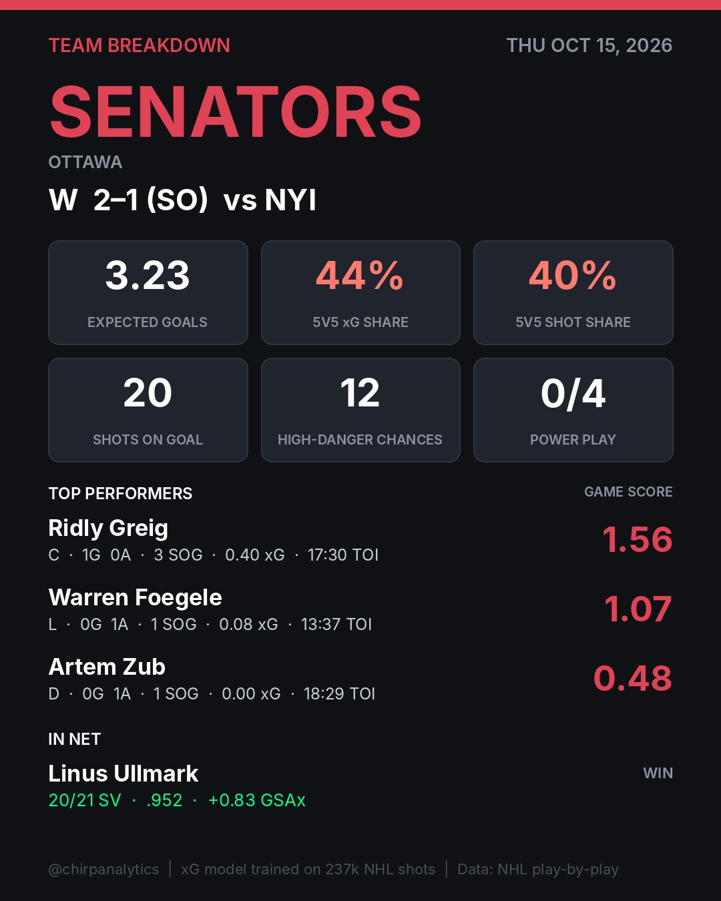

# Chirp Analytics previews

Newest first. Slides and caption exactly as they would post.

## PHI 1 @ DET 2 — 2026-10-15
`game-2026020110` · rendered 2026-10-16 17:44 UTC · mode: preview

  

<details><summary>Caption</summary>

```
Detroit controlled the ice against Philadelphia.

The Detroit Red Wings dominated the expected-goals battle with a 3.46 to 2.18 advantage and a 62% share at 5v5. Lucas Raymond led the way with a 1.57 Game Score, driving the offense alongside Dylan Larkin and Moritz Seider. Did Philadelphia's defense do enough to keep this close?

xG = our shot-quality model, trained on 237k NHL shots. Game Score = Dom Luszczyszyn's single-game value formula. Data: NHL play-by-play.

#NHL #HockeyAnalytics #PhiladelphiaFlyers #DetroitRedWings #RedWings #Flyers #Hockey
```
</details>

## NYR 1 @ NJD 7 — 2026-10-15
`game-2026020113` · rendered 2026-10-16 17:44 UTC · mode: preview

  

<details><summary>Caption</summary>

```
Devils crush Rangers in 7-1 blowout

The New Jersey Devils dominated the New York Rangers by securing a 7-1 victory while posting 5v5 shares of expected goals at 73% and out-attempting the opposition 54 to 30. Luke Hughes led the charge as the first star with 2 goals and 5 shots on goal, anchoring a relentless offensive attack. How did the Rangers defense collapse so completely?

xG = our shot-quality model, trained on 237k NHL shots. Game Score = Dom Luszczyszyn's single-game value formula. Data: NHL play-by-play.

#NHL #HockeyAnalytics #NewYorkRangers #NewJerseyDevils #NJDevils #NYRangers #XG
```
</details>

## VAN 2 @ FLA 3 (OT) — 2026-10-15
`game-2026020112` · rendered 2026-10-16 17:43 UTC · mode: preview

  

<details><summary>Caption</summary>

```
Florida completely dominated Vancouver at 5v5.

The Panthers controlled 62% of the 5v5 expected goals and generated 53 shot attempts to Vancouver's 25. Brady Tkachuk led the charge with a 3.18 Game Score behind 3 goals on 0.58 individual xG. Can Vancouver bounce back after getting outshot 39 to 18?

xG = our shot-quality model, trained on 237k NHL shots. Game Score = Dom Luszczyszyn's single-game value formula. Data: NHL play-by-play.

#NHL #HockeyAnalytics #VancouverCanucks #FloridaPanthers #PuckTracking
```
</details>

## SEA 3 @ TBL 4 (OT) — 2026-10-15
`game-2026020111` · rendered 2026-10-16 17:43 UTC · mode: preview

  

<details><summary>Caption</summary>

```
Tampa Bay edges Seattle in an overtime thriller

Tampa Bay took control at 5v5 with a 51% share of expected goals and controlled the overall flow with 35 shots on goal to 27. Brandon Hagel led the charge with 2 goals, 0 assists, 6 shots on goal, and a 2.24 Game Score. Ryan Winterton and Jared McCann kept Seattle close, but the underlying metrics ultimately favored the Lightning. Did the overtime result reflect the true balance of play?

xG = our shot-quality model, trained on 237k NHL shots. Game Score = Dom Luszczyszyn's single-game value formula. Data: NHL play-by-play.

#NHL #HockeyAnalytics #SeattleKraken #TampaBayLightning #GoBolts #SeaKraken #NHLStats #NHLHockey
```
</details>

## NYI 1 @ OTT 2 (SO) — 2026-10-15
`game-2026020109` · rendered 2026-10-16 17:43 UTC · mode: preview

  

<details><summary>Caption</summary>

```
Sens edge Islanders in a shootout battle

Ottawa dominated the underlying shot quality with 3.23 expected goals to 1.83, while Linus Ullmark delivered a .952 save percentage to lock it down. Ridly Greig led the way with 1.56 Game Score and a crucial goal to power the Ottawa attack. Did the right team win this shootout thriller?

xG = our shot-quality model, trained on 237k NHL shots. Game Score = Dom Luszczyszyn's single-game value formula. Data: NHL play-by-play.

#NHL #HockeyAnalytics #NewYorkIslanders #OttawaSenators #GoSensGo #Islanders #NHLStats #NHLHockey
```
</details>

## BUF 5 @ TOR 4 (OT) — 2026-10-15
`game-2026020108` · rendered 2026-10-16 17:43 UTC · mode: preview

  

<details><summary>Caption</summary>

```
Toronto won the xG battle, but Buffalo took the overtime win.

Toronto edged the 5v5 share of expected goals at 56% to 44%, yet Buffalo managed 35 shots on goal to Toronto's 30. Jack Quinn led the way with 2 goals, 2 assists, and a Game Score of 4.10 to power the Sabres past the Maple Leafs. Did Toronto deserve a better fate with their 2.98 expected goals?

xG = our shot-quality model, trained on 237k NHL shots. Game Score = Dom Luszczyszyn's single-game value formula. Data: NHL play-by-play.

#NHL #HockeyAnalytics #BuffaloSabres #TorontoMapleLeafs #Sabres #Leafs #SabresVsLeafs
```
</details>
